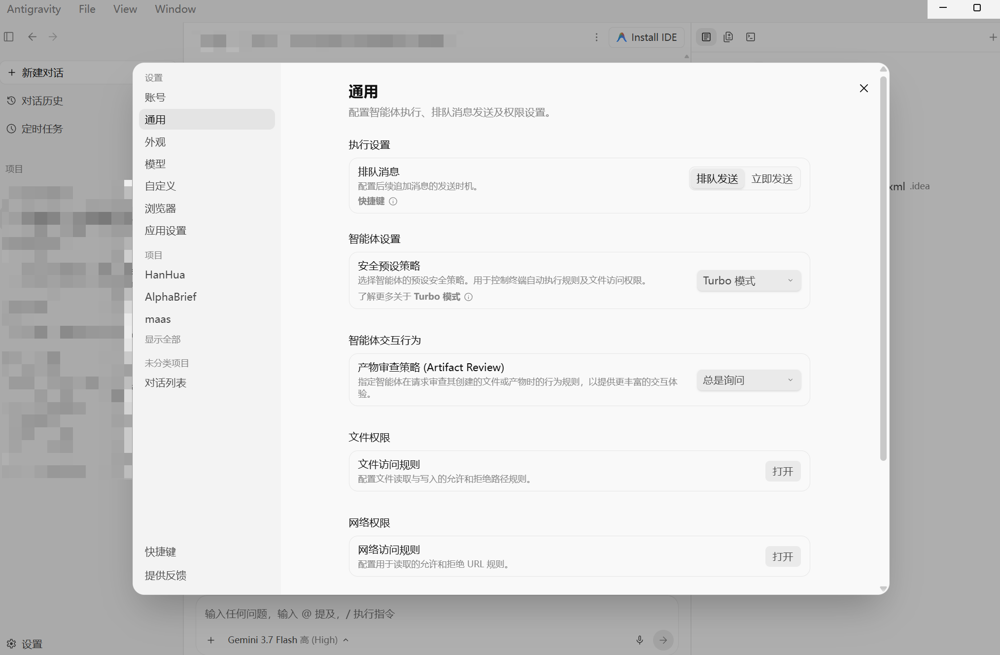
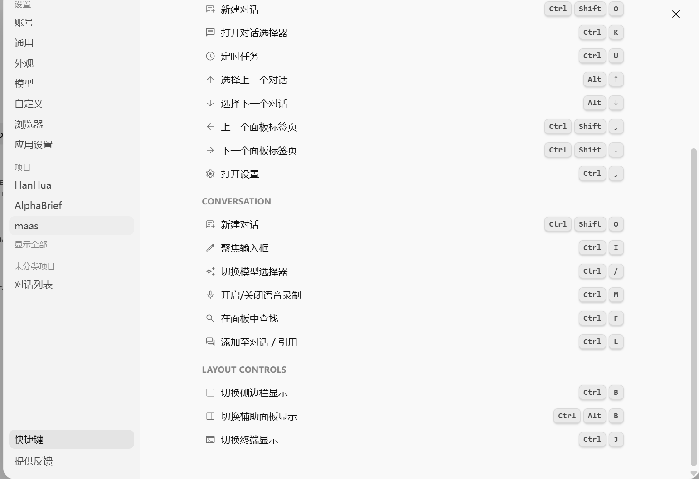
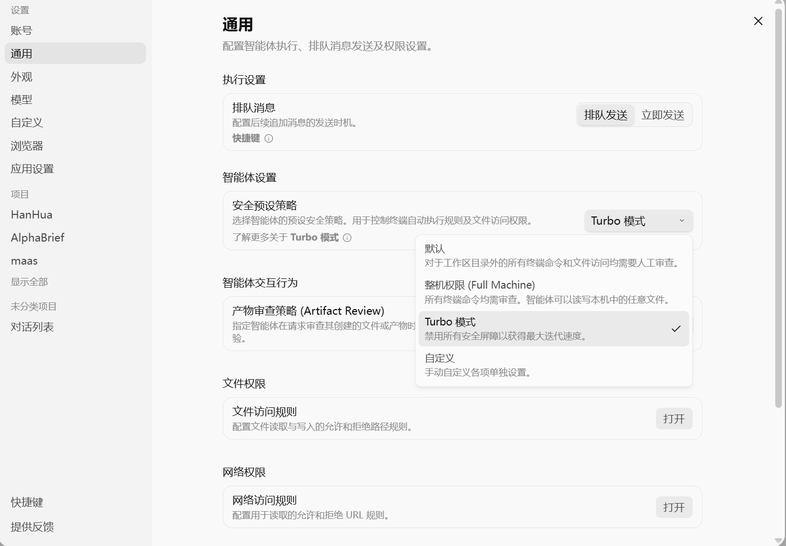

# 🌐 Antigravity 跨平台一键汉化补丁 (Antigravity Chinese Localization Tool)

<p align="center">
  
  
  
  
</p>

专为 **Google Antigravity 客户端**（Standalone Client）打造的跨平台、全自动化、深度汉化与还原工具。

> 💡 **注意**：本项目针对的是 Antigravity 独立客户端程序（`resources/app.asar` 架构），非 Antigravity IDE（IDE 基于 VS Code 内核，可直接在扩展商店安装官方语言包）。

---

## ✨ 核心特性

- 🚀 **一键全自动**：自动智能探测 Antigravity 安装路径，自动备份、解包、注入汉化、重新打包，全流程仅需数秒。
- 🖥️ **跨平台支持**：原生适配 **Windows** 与 **macOS** 双端。
- 📖 **词典完全解耦**：所有汉化内容独立存储在 `dict.json`，支持用户随时手动扩展和维护词条。
- 🔄 **支持一键还原**：每次汉化前自动备份 `app.asar.bak`，随时可通过菜单一键还原为官方原版英文。
- 🛡️ **安全零封号风险**：采用前端安全 DOM 拦截注入技术，不篡改网络通信、后端鉴权与配额计费，纯本地渲染修改。
- ⚡ **动态正则适配**：支持动态 Token 数量、可用预算百分比、明细折叠等动态界面的精准汉化。

---

## 📂 截图 (汉化完成度90%)







---

## 🛠️ 前置环境

运行本工具需要电脑安装有 **Node.js**（版本 $\ge$ 16.0.0）：
- 前往 [Node.js 官方网站](https://nodejs.org) 下载并安装（推荐 LTS 长期支持版）。
- 安装完成后打开终端输入 `node -v`，若显示版本号即代表环境就绪。

---

## 🚀 使用方法

### 🪟 Windows 用户

1. **完全退出 Antigravity 软件**（请检查右下角系统托盘是否退出）。
2. 双击运行 [`一键汉化Antigravity.bat`](./一键汉化Antigravity.bat)。
3. 按照控制台提示：
   - 确认自动检测到的安装路径（直接回车即可）。
   - 选择操作：输入 `1`（或直接回车）安装汉化，输入 `2` 还原原版英文。
4. 重新启动 Antigravity 客户端即可体验中文界面。

### 🍎 macOS 用户

1. **完全退出 Antigravity 软件**（按 `Cmd + Q` 退出）。
2. 打开“终端 (Terminal)”，进入本项目所在目录并执行：
   ```bash
   chmod +x ./一键汉化Antigravity.sh
   ./一键汉化Antigravity.sh
   ```
   *（注：修改 `/Applications` 系统应用需要管理员权限，根据提示输入 Mac 密码即可；若直接执行 node，可使用 `sudo node patch.js`）*
3. 根据终端提示按回车确认路径及操作选项。
4. 重新打开 Antigravity 即可。

---

## 🔄 软件自动更新后的处理

由于 Antigravity 官方在每次版本自动更新时会下载覆盖新的 `app.asar` 文件，导致汉化补丁失效恢复为英文。

**无需担心**：官方更新后，你**只需再次双击运行一次本脚本（耗时约 3 秒）**，脚本会自动重新注入汉化并打包生效！

---

## ✍️ 如何自定义或贡献新词条？

如果你发现某些新界面有未汉化的词条，可以随时自行添加：

1. 用文本编辑器打开 [`dict.json`](./dict.json)。
2. 在 `"exact"` 节点中添加对应的中英文字典：
   ```json
   {
     "exact": {
       "English Text": "中文翻译",
       "Another Button": "另一个按钮"
     }
   }
   ```
3. 保存后重新运行一次汉化脚本即可生效！
4. 欢迎提交 **Pull Request** 将新词条贡献给社区！

---

## ❓ 常见问题 (FAQ)

<details>
<summary><b>Q1: 运行补丁会被 Google 检测并封号吗？</b></summary>

**绝对不会。**  
本工具的原理类似于浏览器的“油猴脚本”或网页翻译插件，仅在 Electron 的渲染层（本地 DOM）将英文字符串替换为中文展示，完全不拦截或修改任何发往 Google 服务器的业务数据、鉴权 Token 与计费接口。
</details>

<details>
<summary><b>Q2: 提示“无法在所输路径中找到 app.asar”怎么办？</b></summary>

请确认 Antigravity 的实际安装位置：
- **Windows 常见路径**：
  `C:\Users\<用户名>\AppData\Local\Programs\antigravity` 或 `C:\Program Files\Antigravity`
- **macOS 常见路径**：
  `/Applications/Antigravity.app`
</details>

<details>
<summary><b>Q3: 解包或重包时提示 EBUSY / 权限拒绝？</b></summary>

这通常是因为 Antigravity 进程尚未完全退出导致文件被占用。请在任务管理器（Windows）或活动监视器（macOS）中结束名为 `Antigravity` 或 `language_server` 的进程后再试。
</details>

---

## 📄 开源许可 (License)

本项目采用 [MIT License](./LICENSE) 协议开源。